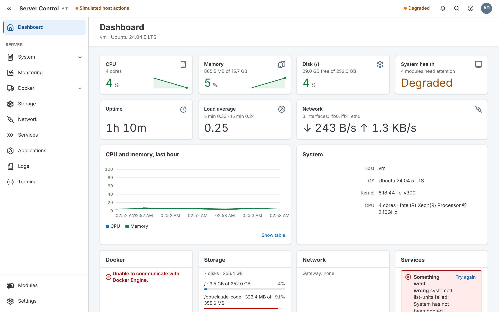
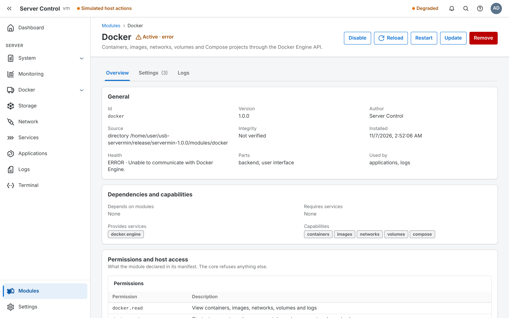
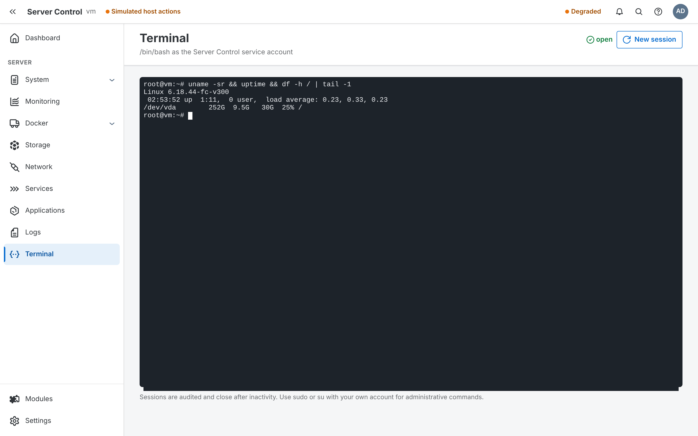

# Server Control (usb-servermin)

A browser-based control plane for a portable Ubuntu Server installation. Boot the USB stick on
any compatible machine, open `http://<server>/`, and manage the system, Docker, storage,
networking, services, applications, logs, a terminal and metrics.

The defining feature is the module architecture: **the core provides infrastructure; modules
provide functionality.** Every feature, including the built-in ones, is an independently
versioned module that can be installed, enabled, disabled, hot reloaded, updated, replaced or
removed without restarting or modifying the core. A module can crash without taking anything
else down.

```
Ubuntu
  └── Server Control core (auth, permissions, module runtime, event bus, REST, WebSocket, SQLite, audit)
        ├── System        ├── Docker        ├── Storage       ├── Network      ├── Services
        ├── Applications  ├── Logs          ├── Terminal      ├── Monitoring
        └── your modules
```

The UI is built with [ENTERPRISE-UI](https://github.com/iant89/ENTERPRISE-UI) only.



<p>
  
  
</p>

## Contents

- [Quick start (development)](#quick-start-development)
- [Install on Ubuntu Server](#install-on-ubuntu-server)
- [Repository layout](#repository-layout)
- [How it works](#how-it-works)
- [Built-in modules](#built-in-modules)
- [Writing a module](#writing-a-module)
- [CLI](#cli)
- [Testing](#testing)
- Further reading: [Architecture](docs/architecture.md) · [Module development](docs/module-development.md) · [Security](docs/security.md) · [Operations](docs/operations.md) · [Releases and updates](docs/releases.md)

## Quick start (development)

Requirements: Node.js 22.13 or newer (for the built-in `node:sqlite` driver) and Python 3 (for the terminal).

```bash
npm install
npm run dev
```

- Shell with hot module replacement: http://localhost:5173
- Core API: http://127.0.0.1:8080
- Privileged operations (reboot, mount, …) are **simulated** in development and logged instead of executed.
- The first visit asks for a setup token; it is printed in the terminal and stored in `.dev/data/setup-token`.
- Edit any file in `modules/<id>/src`: the module is rebuilt and hot reloaded (backend and UI) without restarting the core.

Other commands:

| Command | What it does |
| --- | --- |
| `npm run build` | Build the core, CLI, web shell and all modules |
| `npm run typecheck` | Type-check everything |
| `npm test` | Unit, module and integration tests |
| `npm run package` | Build `release/servermin-<version>.tar.gz` and installable module packages in `release/modules/`; add `-- --bundle-node` to include Node.js |
| `npm run release:keygen` | Create the release signing key (once; see [docs/releases.md](docs/releases.md)) |
| `npm run set-version -- X.Y.Z` | Set the version before tagging a release |
| `npm run update-enterprise-ui` | Rebuild the vendored ENTERPRISE-UI package from a sibling checkout |

## Install on Ubuntu Server

Ubuntu Server 22.04 or newer.

```bash
npm run package                         # on a build machine
scp release/servermin-1.0.0.tar.gz server:
ssh server
tar xzf servermin-1.0.0.tar.gz && cd servermin-1.0.0
sudo ./install.sh                       # --port 8080 to use another port
```

The installer creates the `servermin` service account, installs to `/opt/servermin`, writes
`/etc/servermin/config.json`, installs the privilege helper and its sudoers rule, and enables
`server-control.service`. It prints the address and the one-time setup token.

For a portable USB installation, bundle the Node.js runtime so the stick does not depend on the
host's packages: `npm run package -- --bundle-node [--arch x64,arm64]` downloads the pinned
official build (`servermin.nodeVersion` in `package.json`), verifies its SHA-256 and includes it.

After installing, check everything end to end on the server:

```bash
sudo servermin-verify --user admin            # host setup, privilege boundary, every module (changes nothing)
sudo servermin-verify --user admin --docker   # plus opt-in checks: --mount, --service, --updates, --network-rollback
```

Once installed, a server updates itself from signed GitHub releases: Settings → Updates (or
`serverctl update`) checks daily, installs on request or automatically in a maintenance window, and
rolls back if the new version does not start. Publishing a release is `npm run set-version`, a tag
and a push; see [docs/releases.md](docs/releases.md).

The [real-hardware checklist](docs/hardware-checklist.md) covers the rest: reboots, moving the stick
to another machine, and network rollback with a console attached.

## Repository layout

```
packages/
  sdk/        @servermin/sdk     the module contract: manifest, ModuleContext, events, permissions,
                                 privileged-operation catalogue, config schema, testing utilities
  core/       @servermin/core    the platform: module runtime and registry, auth, event bus, REST API,
                                 WebSocket gateway, SQLite, logging, audit, notifications, process service
  client/     @servermin/client  browser runtime shared by the shell and module UIs: API client,
                                 WebSocket channels, router, frontend registry, React hooks
  shell/      @servermin/shell   the React application shell (ENTERPRISE-UI)
  cli/        serverctl          command-line client for the API
modules/      the nine built-in modules (each: module.json, src/backend, src/frontend, test)
examples/     hello: a minimal module that exercises every extension point
tests/        integration tests and fixture modules
tools/        build, dev and packaging scripts
deploy/       systemd unit, privilege helper, sudoers rule, default config, installer
vendor/       the ENTERPRISE-UI package (built from its repository)
docs/         architecture, module development, security, operations
```

## How it works

- **Module runtime.** Each module backend runs in its own worker thread with a memory limit. Its
  `ModuleContext` is an RPC proxy to the core, so a module only reaches the platform through the
  public API. An uncaught exception, a memory blow-up or a hung lifecycle call terminates only that
  worker; the module goes to `ERROR`, its logs stay available, and *Reload* brings it back.
- **Lifecycle.** `DISCOVERED → VALIDATING → VALID → INSTALLING → INSTALLED → LOADING → LOADED → ACTIVE`,
  plus `DISABLED`, `STOPPING`, `STOPPED`, `RELOADING`, `UPDATING`, `ERROR` and `BLOCKED` (waiting for a
  dependency). Removing a module stops it, unregisters its routes, channels, event handlers and
  services, kills its processes, and optionally deletes its data.
- **Dependencies and replacement.** Modules depend on other modules by id and version range, or on
  *capabilities* (services such as `docker.engine`) that any module can provide. Applications uses
  `docker.engine`, not "the Docker module", so a third-party `docker-manager-pro` that provides the
  same service can replace it without changing the core or Applications.
- **Communication.** Modules never import each other. They publish and subscribe to events
  (`docker.container.started`, `*.metrics`, …) and call declared services through the core.
- **Data.** The core owns all SQLite connections. Each module gets its own database file, so it cannot
  touch core tables or another module's data. Disk-heavy work (module databases, log persistence,
  checkpoints) runs on a separate storage thread, so slow USB flash cannot stall the server.
- **UI.** Each module ships a frontend bundle that registers routes, navigation, dashboard widgets,
  commands and header status indicators at runtime. The shell hard-codes nothing about modules;
  when a module stops, its navigation, routes and widgets disappear.
- **Privilege boundary.** The core runs as `servermin`, not root. Root-only actions are a fixed
  catalogue (`power.reboot`, `storage.mount`, `network.apply`, …) executed by a root-owned helper
  through one sudoers rule. Modules must declare which operations and executables they use, and the
  core refuses anything else. There is no generic "run a shell command" endpoint.

## Built-in modules

| Module | What it does |
| --- | --- |
| **System** | OS, kernel and hardware discovery (CPU, memory, GPU, DMI, machine id), processes, package updates, hostname, time zone and NTP, reboot and shutdown |
| **Docker** | Containers (start, stop, restart, pause, remove, logs, exec, inspect, stats), images and pulls, networks, volumes, Compose projects; Engine API over the socket; provides `docker.engine` |
| **Storage** | Disks and partitions (marks the USB system disk), file systems, usage, mount/unmount with safe locations and confirmation, S.M.A.R.T. health |
| **Network** | Interfaces, addresses, routes, gateway, DNS; static/DHCP configuration through netplan that rolls back automatically unless confirmed, with a warning before you cut your own connection |
| **Services** | systemd services: status, start, stop, restart, enable, disable, journal logs; failure notifications |
| **Applications** | Applications with versions, deployments, environment, ports and domains; deploy container images, Compose stacks, static sites, Node.js apps or existing system services |
| **Logs** | Journal (system and services), container logs and platform/module logs: search, severity filter, live streaming, export |
| **Terminal** | A browser terminal (xterm.js ↔ WebSocket ↔ PTY ↔ shell), audited, with idle timeout |
| **Monitoring** | CPU, memory, disk, network, load and process history, live samples, threshold alerts, and metrics contributed by any module |

## Writing a module

```
modules/my-module/
  module.json           manifest: id, version, permissions, channels, host access, settings, entries
  src/backend/index.ts  default-exports a ServerModule
  src/frontend/index.tsx calls registerFrontend('my-module', { routes, navigation, widgets, … })
  test/*.test.ts        uses createTestContext from @servermin/sdk/testing
```

```ts
import { defineModule } from '@servermin/sdk';

export default defineModule(() => ({
  async initialize(ctx) {
    ctx.http.get('/hello', () => ({ message: `Hello from ${ctx.system.hostname}` }), { permission: 'my-module.read' });
  },
}));
```

Build and install it without touching the core:

```bash
node tools/build-module.mjs modules/my-module --pack
serverctl module install release/modules/my-module-1.0.0.tgz
```

See [docs/module-development.md](docs/module-development.md) and `examples/hello`.

## CLI

`serverctl` talks to the REST API with an API token; it duplicates no platform logic.

```
serverctl login [--url http://server] [--token smt_…]
serverctl status
serverctl module list | discover | info <id>
serverctl module install <dir | package.tgz | git-url> [--sha256 SUM] [--ref REF]
serverctl module update <id> <dir | package.tgz | git-url>
serverctl module enable | disable | reload | restart <id>
serverctl module remove <id> [--delete-data]
serverctl module logs <id> [--level WARN] [--limit 200]
serverctl module config <id> [key=value …]
serverctl update [check]                  # installed and latest version, module updates
serverctl update apply [--yes]            # install the latest release (restart, rollback on failure)
serverctl update module <id>              # install one module package from the latest release
serverctl update auto on|off [--window 03:00]
serverctl update rollback [--yes]
```

## Testing

`npm test` runs:

- **Unit tests** for the SDK (manifest validation, semver, permissions, config) and the core (event bus,
  auth, rate limiting, process service, installer integrity, …).
- **Module tests**: every module is tested in isolation with `createTestContext`, using fake command
  output (and a fake Docker Engine on a Unix socket for Docker).
- **Integration tests** that start a real core with worker threads and SQLite, including the two
  mandatory scenarios from the specification: *install → enable → use → reload → disable → enable →
  remove*, and *module failure → core and other modules unaffected → reload → recovery*. They also
  cover memory-limit isolation, dependency blocking and recovery, archive tamper detection, update
  rollback, permission enforcement, login lockout and WebSocket authentication.
